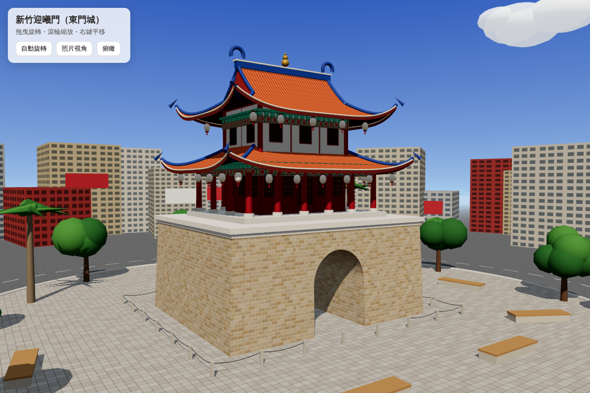

# 新竹迎曦門（東門城）3D 模型

以 Three.js 程式化建模、可在瀏覽器中旋轉檢視的新竹東門城。

## 使用方式

直接用瀏覽器開啟 `index.html`（需要網路以從 CDN 載入 Three.js）。

- 左鍵拖曳：旋轉　滾輪：縮放　右鍵：平移
- 按鈕：自動旋轉／照片視角／俯瞰

## 建模步驟與目的

| 步驟 | 內容 | 目的 |
|---|---|---|
| 0 | 場景、天空漸層、雲、陽光與陰影 | 建立與照片相近的晴天光線 |
| 1 | 城台：正面輪廓（含拱門）擠出成實體，上窄下寬收分，程式繪製砂岩磚紋，頂部白色壓簷 | 還原照片下半部最顯眼的砂岩城台與拱門通道 |
| 2 | 曲面屋頂產生器：以高度函數產生凹曲面＋四角起翹；歇山頂以「超過山花線即只剩前後坡」形成山花面 | 一套函數同時做出腰檐（下層）與歇山頂（上層） |
| 3 | 一樓紅柱迴廊、紅牆格扇門窗、彩繪橫樑、斗拱 | 還原城樓下層開放迴廊 |
| 4–5 | 腰檐＋歇山頂、藍色屋脊、翹角、鴟尾、寶葫蘆 | 做出照片中兩層橘紅瓦屋頂 |
| 6 | 簷下白色燈籠 | 照片中重要的視覺特徵 |
| 7 | 廣場、圓環道路、鐵鍊護欄、石椅、樹、遠處街屋 | 呈現「城市圓環中的古城門」氛圍 |
| 8 | 預設照片視角與互動按鈕 | 開啟即看到與照片相近的構圖 |

主要尺寸（公尺，約略值）：城台 18 × 15 × 8，拱門寬 4.8；城樓總高約 22。
