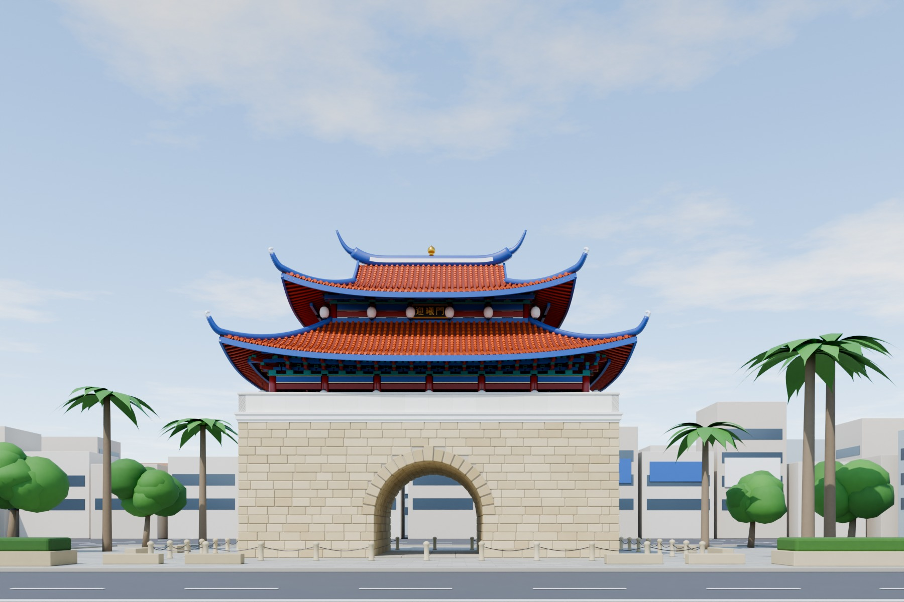
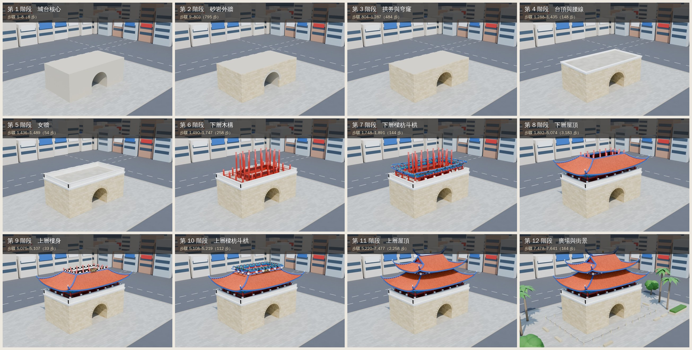

# 迎曦門 Blender 版

用 Blender 5.0（Python 模組 `bpy`）從零程序化重建新竹東門城迎曦門，是 `east-gate-3d/` 網頁版之外的第二件成品。
這一版不限步數：每放上一個構件就記一步，最後以 Cycles 算圖。構件包括一層夯土、一塊砂岩、一片筒瓦、一根椽、一盞燈籠。



## 檔案

| 路徑 | 內容 |
|---|---|
| `build_gate.py` | 建模、材質、燈光、相機、算圖與匯出的完整腳本 |
| `make_sheets.py` | 把各階段算圖排成對照表與動畫 |
| `textures/plaque.png` | 「迎曦門」匾額貼圖（Blender 內建字型沒有中文，先用瀏覽器以文泉驛正黑排字） |
| `viewer/` | 展示頁範本與組裝腳本（照片對照、可旋轉模型、施工階段） |
| `out/east_gate.blend` | Blender 場景，含 12 個施工階段集合、3 台相機 |
| `out/east_gate.glb` | 網頁用模型（Draco 壓縮，無倒角與程序紋理） |
| `out/steps.csv` | 全部建造步驟 |
| `out/phases.csv` | 各階段步驟範圍 |
| `out/renders/` | 照片視角、鳥瞰、翹角特寫、12 張階段圖、對照表、建造動畫 |

## 重現

```bash
python3.11 -m venv venv
venv/bin/pip install bpy==5.0.1 pillow
venv/bin/python build_gate.py --out out --render all --samples 128 --glb
venv/bin/python make_sheets.py out
```

`--render` 可選 `none`、`test`、`hero`、`phases`、`all`。
在 4 核 CPU 上，建模約 2 秒；3 張 1800 px 主圖加 12 張階段圖約 18 分鐘。
也可以直接用 Blender 開啟 `out/east_gate.blend`，切換相機或隱藏階段集合。

## 施工階段

| # | 階段 | 步驟範圍 | 步數 | 內容 |
|---|---|---|---|---|
| 1 | 城台核心 | 1–8 | 8 | 整地放樣，以三合土與碎石夯築城台核心，預留拱道。 |
| 2 | 砂岩外牆 | 9–803 | 795 | 外牆以砂岩條石逐層錯縫砌築，轉角石左右交替咬合。 |
| 3 | 拱券與穹窿 | 804–1,287 | 484 | 砌拱腳側牆，再以楔形拱券石合攏，拱道內以錯縫石環砌成筒形穹窿。 |
| 4 | 台頂與腰線 | 1,288–1,435 | 148 | 台頂鋪石板，沿頂緣安裝線腳腰線。 |
| 5 | 女牆 | 1,436–1,489 | 54 | 砌築女牆、粉刷白灰並安裝壓頂。 |
| 6 | 下層木構 | 1,490–1,747 | 258 | 安柱礎、立朱紅木柱與通柱，砌內牆隔扇，裝欄杆。 |
| 7 | 下層樑枋斗栱 | 1,748–1,891 | 144 | 架額枋、大額枋、平板枋，安裝出跳斗栱、挑簷枋，懸掛燈籠。 |
| 8 | 下層屋頂 | 1,892–5,074 | 3,183 | 釘椽、鋪望板，自簷口往上鋪板瓦與筒瓦，安瓦當滴水、封簷板與垂脊。 |
| 9 | 上層樓身 | 5,075–5,107 | 33 | 砌白牆、開小方窗，懸「迎曦門」匾額。 |
| 10 | 上層樑枋斗栱 | 5,108–5,219 | 112 | 架上層樑枋與斗栱，懸掛燈籠。 |
| 11 | 上層屋頂 | 5,220–7,477 | 2,258 | 鋪歇山屋面，立山花博風，安垂脊、正脊與燕尾。 |
| 12 | 廣場與街景 | 7,478–7,641 | 164 | 鋪設廣場、石柱鏈欄、石椅、植栽、道路標線與周邊街屋。 |

合計 7,641 步，其中筒瓦 3,850 片、台座砂岩條石 795 塊。



## 建模重點

- **比例**：以台座 16 層、每層 0.44 m（高 7.04 m）為比例尺，從照片量出台座寬 19.6 m、拱寬 5.6 m、拱高 5.0 m、下簷約 10.2 m、正脊約 17 m。
- **城台**：核心分 8 層夯築，外牆砂岩逐層錯縫，長度隨機。轉角石左右交替咬合，每塊石頭有倒角與色差。拱券是 19 塊真正的楔形石，中央拱心石較大且外凸。拱道內以錯縫石環砌成筒形穹窿。
- **屋面**：屋頂曲面由舉折曲線生成，上陡下緩，再加上翹角曲線，四角往上翹。下層是環繞樓身的腰簷，上層是歇山頂，有山花、博風板、懸魚與圍脊。
- **瓦作**：筒瓦逐片生成，每片略為錯開以表現搭接。兩列筒瓦之間鋪板瓦，簷口有瓦當與滴水，下方是椽與封簷板。
- **木構**：下層有 18 根簷柱，另有 14 根通柱貫通上下層。斗栱為兩跳，含坐斗、華栱、瓜栱、令栱與散斗。斗栱高度會依上方屋面自動調整，避免穿出屋頂。
- **場景**：天空用多重散射天空貼圖加程序雲層，配合日光。周邊街屋只作遠景比例參考。

## 限制

- 依單張正面照片推估，背面、側面與內部為對稱推測，非實測圖。
- 匾額文字與彩繪是示意，未依實物考證。
